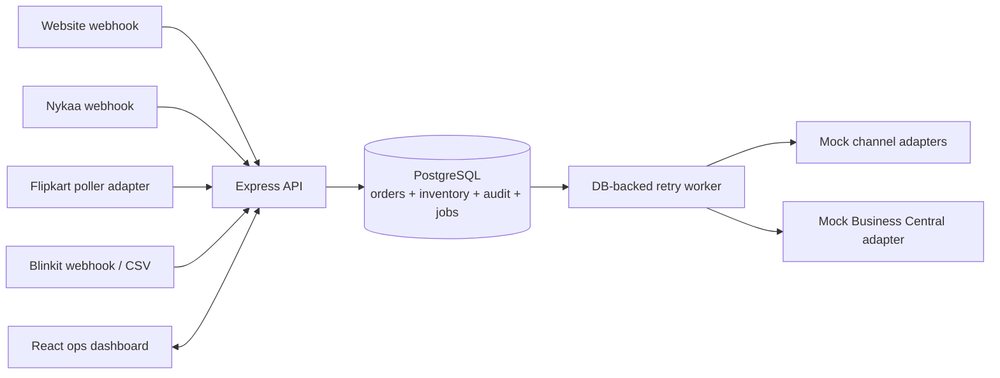

# MARS Order & Inventory Sync

## Goal and scope

An independently runnable Node/Express API and React operations UI collect orders from the website, Nykaa, Flipkart, and Blinkit, reserve central-warehouse stock, and queue stock/ERP work. PostgreSQL is authoritative; this repository's marketplace and Business Central connections are **local mocks only**. The assignment calls for a design exercise, and this implementation is a demo of the design, not a production integration or measured load test.

## Architecture

For the six-week v1, run the independent UI and API as separate services and PostgreSQL as the durable store. In AWS, use a small ECS service for API/workers, RDS PostgreSQL, S3/CloudFront for the static UI, and CloudWatch; validate instance sizing and the ₹50,000/month budget before launch. The local setup uses Docker Compose for PostgreSQL and does not require Redis. A persisted job/outbox record is the durable handoff, so a queue outage cannot erase work.

## Data and consistency

`Product` has a unique SKU; `Inventory` has one row per product with `onHand`, `reserved`, and a monotonically increasing `version`; available is always `onHand - reserved`. `ChannelListing` maps each product to each channel. `Order` is unique on `(channel, externalOrderId)`, and `OrderLine` and `Reservation` are unique per order/product. `InventoryAudit` records timestamp, reason, order, and quantity deltas. `SyncJob` records channel or ERP work, attempts, error, desired absolute quantity, and inventory version. `OutboxEvent` records committed order intent and has a unique event/aggregate key.

Order creation and every line reservation occur in one PostgreSQL transaction. Each reservation is an atomic conditional update (`onHand - reserved >= requested`) and increments `reserved`; a failed line rolls back the whole order. Concurrent updates serialize on the inventory row, so two channels cannot reserve the same final unit. Duplicate webhook delivery returns the existing order and never reserves twice. Cancellation releases an active reservation once. Fulfillment deducts both reserved and on-hand; a later return adds on-hand back once. The demo's fulfillment/return endpoints make that policy explicit.

## Ingestion and delivery

Normalize provider payloads to the common API order shape. Website and Nykaa are webhook-shaped inputs; duplicate/out-of-order event processing is gated by the stable channel order ID and legal order state. Flipkart polling every two minutes and provider authentication/cursors are integration work not connected to real systems here. Blinkit CSV accepts simple comma-separated `order_id,sku,qty,unit_price` rows and reports row errors; quoted commas are not supported. Retryable job records are written in the business transaction. The standalone worker retries with capped exponential delay and marks exhausted work failed; the ops UI can requeue failed jobs. Stock jobs carry absolute desired quantity/version, and older versions are superseded. ERP delivery is at-least-once in general: external exactly-once requires a provider idempotency key or deduplication contract. The local mock uses a unique persisted delivery marker to be repeatable.

The worker is a minimal single-process demo. Its mock adapter throttles Nykaa to 5 calls/s and Flipkart to 10 calls/s, sends one SKU per mock update (within Flipkart's 50-SKU maximum), and injects a retryable Blinkit timeout every 50 calls. It does not implement provider 429 handling, true Flipkart request batching, distributed worker leases, or a real Blinkit timeout circuit breaker; these are production adapter work. Coalesce pending stock updates by listing and always send the newest absolute quantity. Alert when oldest unsent change approaches 60 seconds; at Nykaa's 5 calls/s, 300 unique SKU changes/minute already consumes the full channel budget, so the stated 60-second target needs traffic validation and prioritized/coalesced updates.

## Operations, assumptions, and trade-offs

Day-one alerts: order-ingestion error/duplicate rate; reservation conflicts and rejected-for-stock rate (sale target <0.5%); oldest stock job age and failed jobs by channel; ERP queue age/oldest pending order (including Sunday maintenance); PostgreSQL readiness/connection pressure.

| Decision | Chosen | Rejected | Why |
|---|---|---|---|
| Inventory authority | PostgreSQL row-level atomic reservation | Redis counters or read-then-write | durable audit and no oversell across channels |
| Async work | DB-backed retry jobs/outbox | Redis-only queue | durable intent when queue is unavailable; simpler for 3 developers and budget |
| Provider integration | Local adapter boundary and mocks | Real seller APIs/credentials | exercise failure paths without external access |
| Returns | Restock only after fulfillment | Restock every cancellation/return identically | prevents returning unshipped reserved stock twice |

Assumptions: one warehouse; integer sellable quantities; each order line has a unique SKU; prices are INR; event timestamps may be absent; marketplace payloads can be normalized to the documented API; cancellation is valid only before fulfillment; returned goods are sellable (inspection/quarantine is out of v1); mock adapter results do not prove provider behavior. AI tool use: GitHub Copilot was used to draft and implement the local application and documentation; decisions and code remain subject to review.

## Deliberately out of v1

Authentication/RBAC, real provider credentials, warehouse transfers, payment/refund processing, partial fulfillment/returns, damaged-goods quarantine, and production deployment/observability are excluded to fit the six-week/three-developer constraint. Add auth before exposing operational or webhook endpoints publicly. No cost estimate or throughput result is asserted without deployment/load testing.
